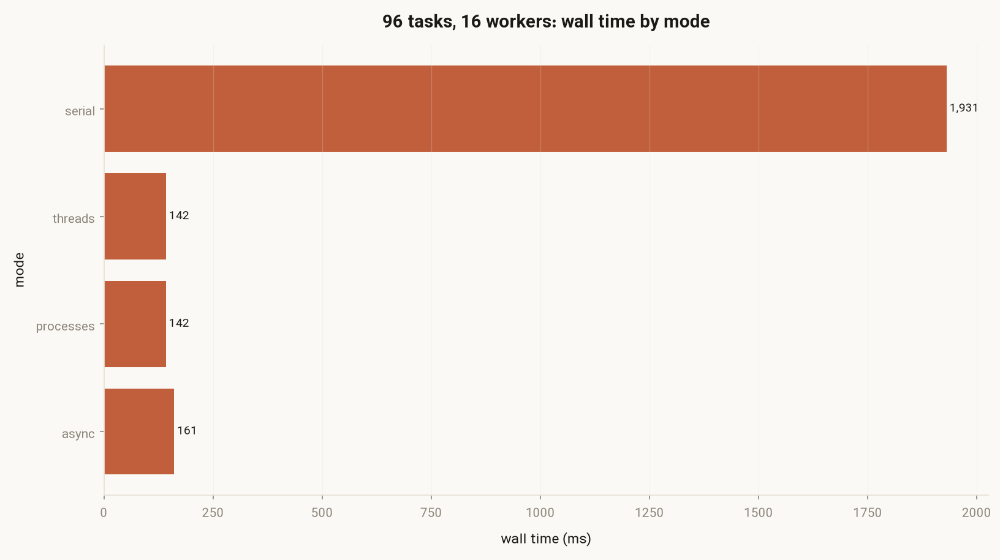

# threadwise

**Measure whether your Python should be serial, threaded, multi-process, or async — before you rewrite anything.**

Everyone knows the GIL exists. Almost nobody knows whether *their* code is affected by it. `threadwise` answers that with numbers in about twenty seconds, and refuses to answer when the machine can't tell you anything useful.

```console
$ threadwise bench io-latency -n 96 -w 16
threadwise  ·  io-latency
Simulated 20-30 ms network-ish latency (sleep-based)
python 3.12.15 · 16 cpus visible · 1.00 usable (cgroup v2 limit) · 96 tasks · 5 repeats · median of wall time

mode             time   per task   speedup    eff.   vs serial
──────────────────────────────────────────────────────────────
serial        1.931 s      20 ms   1.00×       —  ████··········
threads       142 ms    1.48 ms  13.55×     85%  ██████████████ ✓ recommended
processes     142 ms    1.48 ms  13.57×     85%  ██████████████
async         161 ms    1.68 ms  12.02×     75%  ██████████████
note: process pool startup was 46 ms, measured outside the timed region

✓ every mode produced identical results (checksum match)

verdict
  use threads — 13.55× faster than running serially across 16 workers.

why
  • Threads gave 13.55x: waiting on I/O costs no CPU, so the GIL is not the bottleneck.
    Concurrency is enough; you do not need processes.
  • async note: true coroutine suspension, no OS thread per request.
```



That output is real, from this repository's own run on a 1-core-quota container: even with a single CPU, 16 concurrent waits still finish 13.5× sooner. That is the whole lesson — **concurrency is about waiting, parallelism is about cores**.

---

## Why not just use `timeit`?

Because `timeit` times one loop and you still have to guess afterwards. `threadwise` runs the *same task list* four ways, checks every mode returns the same answer, and then tells you which one to ship:

| mode | what it does | what it is for |
|---|---|---|
| `serial` | one task after another | the baseline every speedup is measured against |
| `threads` | many tasks, one interpreter, one GIL | I/O: requests, files, sockets |
| `processes` | many interpreters, real cores | CPU: parsing, hashing, pure-Python loops |
| `async` | many tasks on one event loop | high-concurrency network I/O |

## Install

```bash
pip install threadwise            # core, no dependencies
pip install "threadwise[numpy]"   # adds the NumPy workload
```

Python 3.10+. No dependencies in the core package.

## Use it

```bash
threadwise bench                          # every built-in workload
threadwise bench pure-python-cpu          # one workload
threadwise bench ./my_job.py              # your own code
threadwise bench --json > bench.json      # machine-readable
threadwise bench -w 4 -r 5 --all          # 4 workers, 5 repeats
threadwise bench --html report.html       # self-contained HTML report
threadwise sweep ./my_job.py --sizes 1,2,4,8,16   # where does it stop scaling?
threadwise sweep io-latency --html scaling.html   # sweep + charts, one file
threadwise modes                          # what the four modes mean
threadwise workloads                      # what ships in the box
```

### Benchmark your own code

Point it at a file that defines one function:

```python
# my_job.py
KIND = "cpu"                 # "cpu" or "io"  (optional, defaults to cpu)

def run(seed: int) -> int:   # one independent unit of work per call
    return parse_one_invoice(seed)
```

```console
$ threadwise bench ./my_job.py
```

Two rules for a fair measurement:

1. **`run(seed)` must be independent.** It will be called concurrently from many workers; do not rely on shared mutable state.
2. **One call should cost ≳10 ms.** If a task takes 0.2 ms, you are measuring scheduling overhead, not your code. Batch the work: `examples/parse_invoices.py` processes 120 invoices per task.

Optional: define `async def arun(seed)` to enable the `async` column for I/O workloads. Without it, `async` is reported as `n/a` instead of being faked.

## The part most benchmarks get wrong

- **Warmup run, then median of N repeats.** The first run pays for imports and cold caches; the median ignores the one noisy outlier. `min` is reported in JSON for comparison.
- **Identical results are a hard requirement.** Every mode returns a checksum; if the modes disagree, the table says so instead of ranking garbage. (A speedup is worthless if you changed the answer.)
- **Pool and executor startup is measured, but outside the timed region**, and printed. On this machine a process pool costs ~40-50 ms to build — for a 20 ms job, that dominates, and you should know it.
- **BLAS thread settings are pinned.** OpenBLAS defaults to dozens of threads; left alone it oversubscribes the machine and every number becomes noise. `threadwise` sets `OPENBLAS_NUM_THREADS=1` etc. so you measure *your* scheduling choice.
- **The CPU budget is detected, not assumed.** `os.cpu_count()` reports the host's cores even when a cgroup quota says you may use one. `threadwise` reads cgroup v1/v2 and reports *usable* CPUs, then refuses to give a CPU verdict when that number is ~1:

```console
$ threadwise bench pure-python-cpu
python 3.12.15 · 16 cpus visible · 1.00 usable (cgroup v2 limit) · 4 tasks · 3 repeats

mode             time   per task   speedup    eff.
serial          80 ms      20 ms   1.00×       —
threads         69 ms      17 ms   1.16×    116%
processes       79 ms      20 ms   1.02×    102%

verdict
  no verdict — only 1.00 CPU is usable here. Every mode is forced to share one core,
  so the ranking measures the machine, not your code.
```

A tool that says "use threads, 1.16×!" from one core is lying to you. This one says so.

## Where does it stop scaling?

A single "13.6× on 16 workers" cannot tell you whether 32 workers would double
throughput or waste money. `sweep` measures the curve and fits Amdahl's model
`S(N) = 1 / (s + (1-s)/N)` to it:

```console
$ threadwise sweep io-latency --sizes 1,2,8,16 -n 96 -r 3
threadwise sweep  ·  io-latency · threads
96 tasks · baseline (serial) 1.940 s · median of repeats

 workers   wall time   speedup  efficiency
──────────────────────────────────────────────────────────────────
       1     1.940 s     1.00×        100%   ████··········
       2      971 ms     2.00×        100%   ███████·······
       8      263 ms     7.38×         92%   ██████████████
      16      142 ms    13.63×         85%   ██████████████

Amdahl fit: serial fraction 1.3%, ceiling ≥87× (curve had not bent), R² 1.000

notes
  • no measurable ceiling: at 16 workers the curve is still 85% efficient and the
    fitted 87x sits well past the 13.6x we actually measured. Read it as a lower
    bound; sweep another doubling if you need to know where it bends.
```

That last note is the point. A naive fit happily reports a tidy ceiling far
outside the data; `threadwise` marks it `≥` and tells you it is a lower bound.
When the curve *has* bent, the ceiling and the "90% of it arrives by N workers"
line tell you exactly how much hardware is worth buying.

## The HTML report

```console
$ threadwise bench --html report.html
$ threadwise sweep io-latency --html scaling.html
```

One self-contained file: inline SVG charts, no CDN, no external images, no
JavaScript required to read it, prints to PDF cleanly, and the raw JSON is
embedded in the page so a reviewer can re-derive every number. A generated
example lives in [`docs/sample-report.html`](docs/sample-report.html).

## Built-in workloads

| name | kind | what it measures |
|---|---|---|
| `pure-python-cpu` | cpu | interpreter-bound arithmetic — the classic GIL victim |
| `numpy-cpu` | cpu | matrix multiplication — CPU work inside C, GIL released |
| `io-latency` | io | 20-30 ms simulated network latency |
| `io-disk` | io | 512 KB write + `fsync` + read + hash per task |

`io-latency` is deliberately labelled *simulated*: it isolates scheduling behaviour without depending on your network. `io-disk` is real blocking I/O.

## JSON output and CI

```bash
threadwise bench --json > bench.json
```

```json
{
  "results": [
    {
      "mode": "threads",
      "median_s": 0.172138,
      "per_task_ms": 2.69,
      "startup_ms": 0.06,
      "speedup": 7.55,
      "efficiency": 0.944,
      "checksum": "5388c073fd36",
      "error": null
    }
  ],
  "verdict": { "recommended": "threads", "speedup": 7.48, "results_identical": true }
}
```

All four modes in that run produced checksum `5388c073fd36`. Same answer, different schedule.

Benchmarks are noisy on shared CI runners; treat the *ordering* of modes as the signal and the exact decimals as noise. The exit code is always 0 — this is a measuring tool, not a linter gate.

## Limitations, stated plainly

- Workloads are **independent tasks**. If your code shares a lock, a cache, or a database connection, thread speedup will be lower than this predicts — you still need to profile.
- The benchmark measures **throughput of a batch**, not p99 latency under load.
- Cross-process tasks pay **pickling** for every argument and result. If your payload is large, the numbers already include that cost, but you should still look at it.
- `async` only helps if your I/O is **genuinely awaitable**. `asyncio.to_thread` inside a coroutine is threads with extra steps, and the report says exactly that.
- Custom scripts rely on the `fork` start method to avoid re-importing your file (default on Linux and macOS ≤3.13).

## Development

```bash
git clone https://github.com/seyyed-sajjad-fazeli/threadwise
cd threadwise
python -m pip install -e ".[numpy,dev]"
make test      # 43 tests, no network required
make bench
```

Layout:

```
src/threadwise/
  workloads.py   the four workloads and their contract
  runners.py     serial / threads / processes / async engines + cgroup-aware CPU budget
  bench.py       orchestration, speedups, and the verdict logic
  sweep.py       worker-count sweep + Amdahl fit (with lower-bound detection)
  insight.py     cost model, batching prediction, one-line decision
  report.py      terminal table, markdown, sweep view, colour
  htmlreport.py  self-contained HTML report with inline SVG
  loader.py      load your own script as a workload
  cli.py         argument parsing
tests/           43 unit tests (unittest or pytest)
```

## License

MIT © Seyyed Sajjad Fazeli
